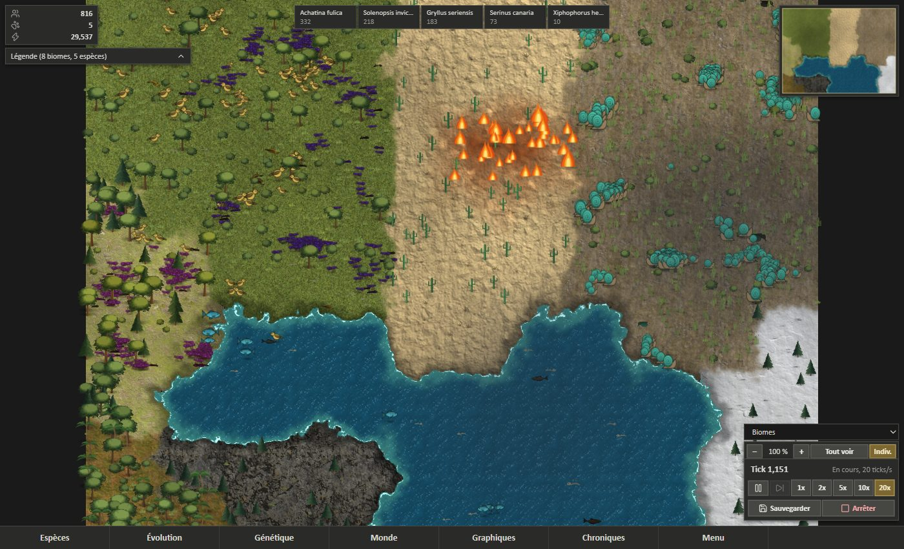
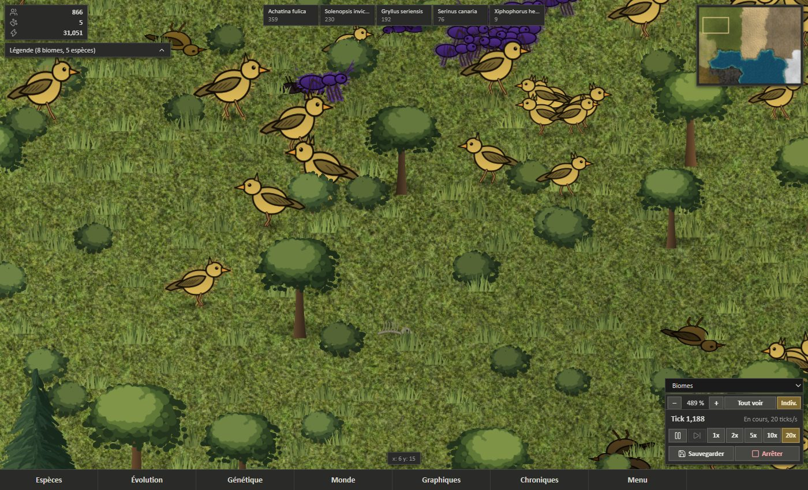
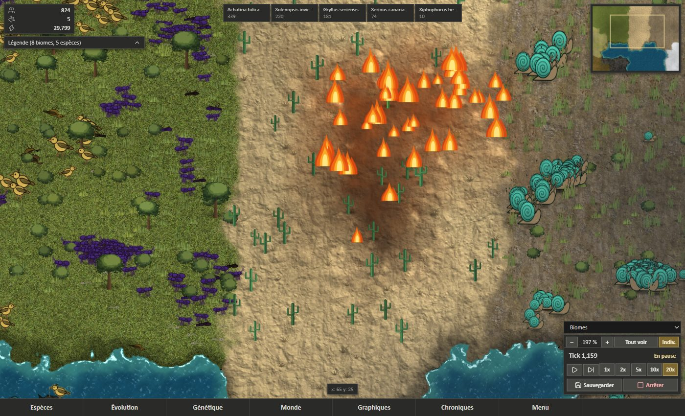
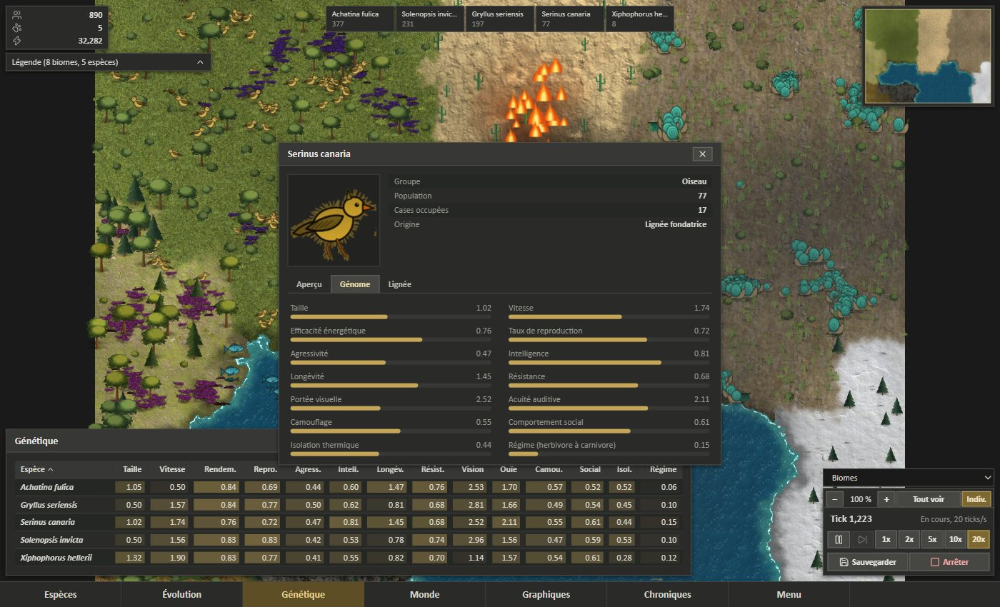
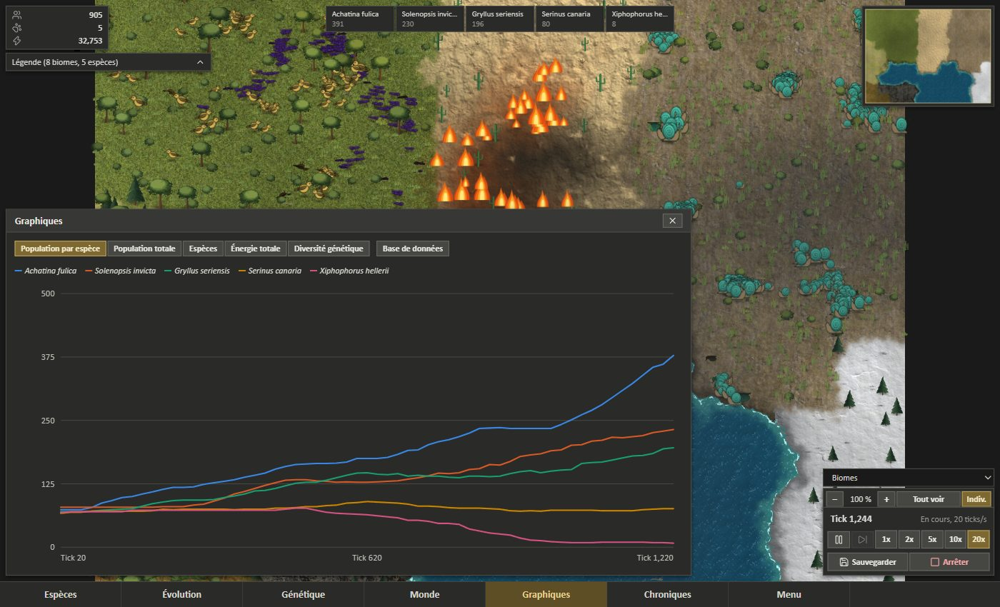

# Serina

[](https://github.com/SaniAdamou14/Serina/actions/workflows/ci.yml)

An evolutionary ecosystem simulator: a C++20 engine, a Node.js/PostgreSQL API
and a React dashboard. It starts from the premise of *Serina: A World Without
Humans*: five founder species (canaries, tropical fish, crickets, fire ants,
giant land snails) are introduced to an empty world and left to diversify.

The long-term goal is the systemic depth of Dwarf Fortress, applied to
evolution, on the real Earth, with the interface and robustness of RimWorld or
better. The project is far from that today. [`docs/ROADMAP.md`](docs/ROADMAP.md) has the measured
starting point and the plan.


## Screenshots

All captured from the running game, with real engine data.



*The whole map. Each creature is a real individual, and plants follow each cell's real level.*



*Up close: the dead stay where they fell, turn brown, then leave bones.*



*A fire lit by lightning, not scripted. It burns the plants of the cell and hurts creatures on the ground.*



*Genome of a species: the average of its real diploid traits.*



*Population by species, recorded by the engine.*

## What works today

**The engine** (`UnifiedWorldSimulator`, `include/Serina/WorldSimulation.hpp`):

- Individuals with diploid genomes (12 traits, crossover, mutation), on a
  12×9 grid of procedurally placed biomes.
- One NEAT brain per lineage, shared by its individuals, driving movement and
  hunting, evasion and foraging effort.
- Foraging with density regulation, predation as an energy transfer, and
  competition between species.
- Speciation when two regional groups of a species stay genetically divergent.
- Full save and resume, bit-identical to a run that was never interrupted.
- A seed gives the same world under GCC and MSVC (`tests/test_determinism.cpp`).

**The web stack:**

- A map of the real grid and individuals with zoom, overlays, a minimap and
  inspection panels.
- A phylogenetic tree built from real speciation events, a species comparison
  view, an event journal and history charts.
- Live speed control, save and restore.

## Known limitations

These are measured or read from the code. See the roadmap for the details.

- **Adaptation to climate works between species, not inside one**: insulation moves
  towards what the climate demands (mean gap 0.25 without selection, 0.12 with it on
  unseen seeds), but each species lives in a narrow range of climates, so there is no
  measurable local adaptation within a species. Biomes never change.
- **Few species**: a split needs real geographic isolation, and a 12×9 map has few
  real barriers, so most splits come from diet. Worlds hold about 11 species after
  20000 ticks. Founder groups are not always safe: fish survive in about half of
  worlds at that length, birds and arthropods in about 5 out of 6.
- **Several traits have no direct effect on survival** yet: intelligence, hearing,
  camouflage, social behavior and reproduction rate.
- **Weather and fire are not measured**: storms, lightning and fire are simulated and
  drawn, but their effect on survival and on radiation has not been benched yet.
- **The food chain is young**: plants limit each cell, though they stay about 80%
  full. Canaries radiate into about 2 bird species over 20000 ticks, up to 3, holding
  2 diet niches out of 3, never all three.
- **The engine does not scale to a planet**: about 5 µs per individual per tick
  on one core, and 2.7 KB of memory per individual.
- **The API has no authentication**, so it should only run locally.

## Architecture

```
serina_daemon (C++, persistent)
  keeps UnifiedWorldSimulator instances in memory, steps them on its own thread
  TCP JSON-lines on 127.0.0.1:7331
        ^
        | persistent TCP (api/services/daemonClient.js)
        |
api (Node, Express, Socket.IO)
  polls the daemon, stores snapshots and history in PostgreSQL when connected
        |
        | Socket.IO + REST (/api/serina/*, /api/simulations/*)
        v
web (React, TypeScript, Vite)
```

Protocol reference: [`docs/SERINA_DAEMON_PROTOCOL.md`](docs/SERINA_DAEMON_PROTOCOL.md).
Engine design: [`docs/UNIFIED_ENGINE_DESIGN.md`](docs/UNIFIED_ENGINE_DESIGN.md).

## Running it

Build the engine and run its tests:

```bash
cmake -S . -B build -DCMAKE_BUILD_TYPE=Release
cmake --build build --config Release
ctest --test-dir build --output-on-failure -C Release
```

Start the API and the dashboard:

```bash
npm install   # at the repository root, this installs the api and web workspaces
npm run dev   # api on port 3001, web on port 3000
```

`npm run dev` rebuilds `serina_daemon` when the C++ code is newer than the executable, and the
API starts it if it is not already running. An engine with the wrong protocol version is refused.

PostgreSQL is optional. Without it, live simulation still works, but history
and saved simulations are unavailable. Connection settings are in
`api/.env.example`.

## Changing the model

`tests/test_determinism.cpp` pins a hash of the world produced by one seed. When
you change the model on purpose, update that value in the same commit, and check
that CI gives the same value on Linux and Windows. Use `Det::` from
`include/Serina/DeterministicRandom.hpp` instead of `std::` distributions,
`std::shuffle`, `std::exp` or `std::tanh`, and don't let results depend on the
iteration order of an `unordered_map`.

## License

MIT, see [`LICENSE`](LICENSE).
